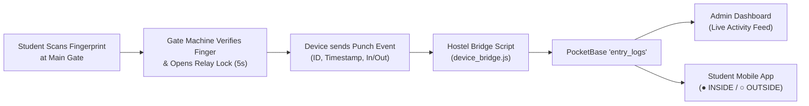

# 🚪 Main Gate Biometric Fingerprint Integration Guide

This guide explains how to connect your physical gate fingerprint scanner / turnstile machine (eSSL, ZKTeco, Mantra, Realtime, etc.) to the Hostel Management Portal and Student Mobile App.

---

## ⚡ How It Works



1. **Gate Access**: When a student places their finger on the sensor, the machine verifies them and triggers the relay to unlock the magnetic gate / turnstile.
2. **Attendance Recording**: The machine creates a punch timestamp (`IN` or `OUT`).
3. **Instant Sync**: The bridge saves the event to PocketBase `entry_logs`.
4. **Live Updates**:
   - The **Admin Dashboard** displays the student name, punch time, direction, and method in real time.
   - The **Student App** updates their status badge (`● INSIDE HOSTEL` / `○ CURRENTLY OUTSIDE`) and logs history.

---

## 🛠️ Step 1: Enrolling Students on the Gate Machine

When enrolling a student's fingerprint on the gate device:
1. Go to **Device Menu -> User Mgt -> New User**.
2. Set **User ID / Reg No**: Enter the student's **10-digit Phone Number** (e.g. `9876543210`) or their Admission ID.
3. Enroll their fingerprint (press 3 times on the scanner).
4. Save.

> **Why Phone Number?**  
> Using the student's phone number as their Machine User ID makes it automatically link to their profile in PocketBase without manual mapping!

---

## 🔌 Step 2: Choosing Your Device Connection Method

### Option A: Local WiFi / LAN Network (eSSL & ZKTeco devices)
Most gate machines have an Ethernet port or WiFi and communicate over port `4370`.
1. Assign a static IP to the gate machine (e.g., `192.168.1.201`).
2. Run the bridge on any hostel PC or Raspberry Pi connected to the same network:
   ```bash
   node scripts/biometric/device_bridge.js --ip 192.168.1.201
   ```

### Option B: Cloud Push / ADMS (Built-in Web Server)
If your machine has **ADMS / Cloud Server** in its menu:
1. In device menu: **Comm. -> Cloud Server Settings (ADMS)**.
2. Set Server Address: your server IP or domain (e.g. `your-hostel-domain.com`).
3. Set Server Port: `5050` (or `80` if reverse proxied).
4. Run the webhook server:
   ```bash
   node scripts/biometric/device_bridge.js --server
   ```
   The device will automatically POST punches to `/api/biometric/punch` whenever a finger is scanned!

---

## 🧪 Testing Immediately (Simulation Mode)

You can simulate a live fingerprint scan without needing the physical machine connected:

```bash
node scripts/biometric/device_bridge.js --test
```

This will:
1. Pick an active resident from your database.
2. Record an Entry/Exit punch in PocketBase `entry_logs`.
3. You can see it live on:
   - **Admin Dashboard**: `http://localhost:5174/` (Live Gate Activity panel)
   - **Student App**: `http://localhost:5174/student` (Biometric Attendance card)

---

## 📦 Running as a Permanent Background Service (Windows / Linux)

To keep the bridge running 24/7 on the hostel computer:

### On Windows (using PM2):
```bash
npm install -g pm2
pm2 start scripts/biometric/device_bridge.js --name "gate-bridge"
pm2 save
pm2 startup
```

### On Linux / Raspberry Pi (using systemd):
Create `/etc/systemd/system/gate-bridge.service`:
```ini
[Unit]
Description=Hostel Gate Biometric Bridge
After=network.target

[Service]
Type=simple
User=pi
WorkingDirectory=/home/pi/HostelDashboard
ExecStart=/usr/bin/node scripts/biometric/device_bridge.js --server
Restart=always

[Install]
WantedBy=multi-user.target
```
Then run:
```bash
sudo systemctl enable --now gate-bridge
```

